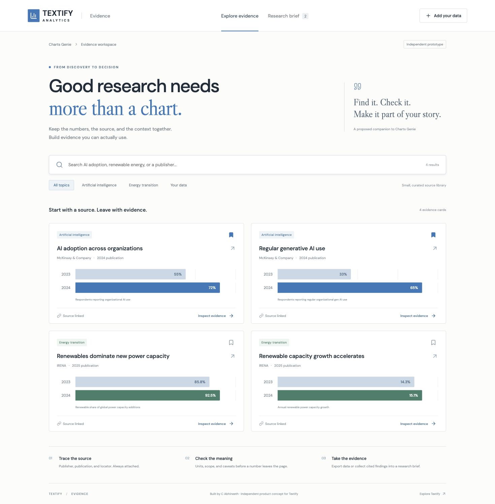

# Textify Evidence

A focused chart-to-citation workbench built by C Abhineeth as an independent product concept for Textify Analytics.

Textify's public product page describes Charts Genie as a chart discovery tool. This prototype explores the next task: preserving a finding's source, units, scope, and limitations when taking it into a report. It proposes an extension; it does not claim that Textify lacks these features internally.



## Run locally

Requires Node.js 20.19+ or 22.12+.

```sh
npm ci
npm run dev
```

Open http://127.0.0.1:5178/.

```sh
npm test
npm run build
```

## Working features

- Search a small curated library by topic, publisher, title, and metric.
- Inspect source links, publication dates, exhibit locators, units, population, and caveats.
- See reported values alongside first-to-last absolute and relative change. Percentage points are explicitly distinguished from percentage growth.
- Save findings into a research brief, retained on this browser after reload.
- Copy citations, export raw chart CSV, and export a cited Markdown research brief.
- Add a CSV file or paste CSV with source metadata. Numeric values, unique labels, headers, and row count are validated. Imported data is clearly marked as user-provided.
- Remove imported records or remove saved findings from the brief.
- Use responsive layouts and dialogs with Escape dismissal and keyboard focus containment.

## Deliberate boundaries

This is a browser-local React/Vite application. It does not connect to Textify's private dataset, perform multimodal extraction, call an LLM, or run production semantic retrieval. Search is deterministic keyword matching across the four bundled historical evidence records and your imports. No API keys are required. Uploaded content stays in browser memory/local storage. Google Fonts is requested for typography; local system fonts are fallbacks.

The four records contain small, manually transcribed factual observations from these primary publications:

- [McKinsey: The state of AI in early 2024](https://www.mckinsey.com/capabilities/quantumblack/our-insights/the-state-of-ai-2024), May 30, 2024. Organizational adoption and regular generative AI use.
- [IRENA: Renewables in 2024, 5 key facts](https://www.irena.org/News/articles/2025/Apr/Renewables-in-2024-5-Key-Facts-Behind-a-Record-Breaking-Year), April 2025. Renewable capacity growth and share of power capacity additions. Later publications may revise historical figures.

No publisher chart images or proprietary datasets are bundled. The charts are rendered locally from the observations. Historical snapshots are not presented as the latest available figures.

## Why this fits Textify

- Product basis: https://textify.ai/product/
- Public search product: https://analytics.textify.ai/
- Public GitHub organization reviewed: https://github.com/T3xtifyai

The public descriptions support the chart discovery use case. Access to the live website was unreliable during research; an archived screenshot supplied broad visual cues: white surfaces, dark typography, and blue chart accents. This is an original companion design, not a verified reproduction of their current interface or internal stack.

A future integration could attach the evidence schema in `src/data.js` to real retrieval results. Source locators, extracted values, retrieval metadata, and review status would need server-side validation before production use.

## Screenshots and outreach

The `screenshots/` folder contains three actual local-browser captures, not generated mockups:

1. `01-evidence-library.jpg`: discovery and chart cards.
2. `02-source-and-context.jpg`: a finding's source, scope, and caveat.
3. `03-research-brief.jpg`: portable collection with citations.

Use screenshots 1 and 3 for the shortest email. `OUTREACH.md` contains copy-ready email text. `VERIFICATION.md` records checks and limits.
